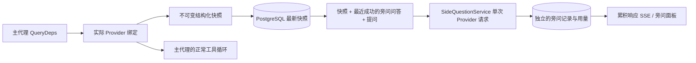

# LANCE `/btw` 附带提问

普通聊天、任务的 MainAgent, 以及当前任务直接启动的 Worker, 都各自支持与正文对话分离的旁支提问。在主输入框输入 `/btw 问题` 即可提交旁支提问; 只输入不带内容的 `/btw` 或点击“旁支提问”按钮, 则打开此前的旁支提问记录。桌面端以可调宽度的侧边栏显示, 移动端以抽屉(Drawer)显示。

旁问响应基于提交问题时的代理上下文快照生成，支持流式显示、追加提问、停止和清空。关闭面板、刷新页面或 SSE 连接断开都不会取消模型请求。停止仅影响当前正在进行的一个旁问；清空会取消旁问并删除旁问记录，但保留正文上下文快照。

## 实现范围

沿用 Go、norma v0.3.7、Next.js 以及现有的 Markdown · ResizablePanel · Drawer · AlertDialog 组件，未修改 norma 源码，也未为附带问题新增依赖。Planner、从其他任务接手的 Worker、工具型子任务的提升不在本次范围内。

- `capture.go` 仅在 `Options.Deps.CallModel` · `CallModelSync` 中标记为主循环请求。Provider 装饰器位于单独模型内部、即路由池之外选定模型后的下一步，因此记录实际选中的模型。压缩请求与摘要请求不会覆盖快照。
- 在请求开始的时刻、模型完成响应的时刻、执行到达结束状态的时刻发布快照。生成中途的半截响应不发布。工具调用经由 norma 的 `MessagesForAPI` 保持配对，工具结果会在下一次主模型请求或执行结束状态时进入快照。流式传输中断时保持上一个有效边界。
- 快照通过 JSON 深拷贝保留结构化消息、系统提示词、工具定义和生成参数。模型推理不持有快照锁或数据库事务。
- `SideQuestionService` 调用单独的 Provider。必要时先生成侧问摘要；最终响应仅在上下文首次超限且尚未输出文本或工具调用时，缩小一次并重试。不会新建代理会话，不连接工具执行器、主 transcript、活动流和任务图，也不经过任务模型切换链。响应保留工具定义是为了兼容既有的结构化工具上下文，摘要请求不提供工具。新返回的工具调用没有执行路径。
- 每个上级会话同时只有一个执行中的请求，每个服务进程最多四个，单个请求超时时间为 120 秒。侧问在服务生命周期下使用独立的取消上下文。
- 侧问请求保存模型配置引用与非敏感的标识信息摘要，并在发起请求时从既有配置中取用凭据。若配置被删除，或模型、协议、地址等标识字段发生变化，则要求先运行主代理以刷新快照。测试不改变产品默认模型。

## 持久化与恢复

`db/schema.sql` 会自动创建 `side_question_sessions` 和 `side_question_requests` 表。前表保存父级资源、最新快照、执行编号、版本、清理版本，后表保存问题、累计响应、状态、模型、快照时间、用量、事件序号、页序号。

父会话键使用 conversation ID，或组合使用 task ID、exploration ID 和 intent ID。Worker 不使用可复用的执行槽名称。

快照按父会话为单位合并记录，每 250 毫秒刷新一次，并由数据库比较 `(run_id, version)`，阻止旧版本覆盖最新版本。提交附属问题前，会再保存一次选中的快照。保存成功则释放内存中的大快照；失败则保留尚未记录的版本。累计响应内容在流式事件到达时最多每 250 毫秒记录一次，在结束状态下立即保存，但数据库出错时仅重试有限次数。

服务启动时，会将此前仍处于 `running` 状态的请求标记为 `interrupted`，已保存到数据库中的部分响应和用量保持不变，并且不会自动重新执行请求。最近一次成功保存的上下文可直接用于下一个问题。若旧会话没有快照，则要求先运行主代理，而不会从 UI 活动记录中重新构建上下文。

清空操作会将清理版本递增一，删除请求，并阻止条件更新重新记录迟到到达的回调。物理删除父资源时交给外键级联处理；逻辑删除 Worker 时，在同一事务中一并删除附属问题数据，然后拒绝此后迟到到达的快照。归档任务时，先阻止新请求，等待主流程停止，取消附属问题，然后等待写入数据库。归档格式为 v3，也兼容没有附属问题表的 v1 · v2。

记录会完整保存，并基于序号游标每页最多返回 20 条。模型请求会重新附带最近成功问答的原文，最多 20 组，但会按 token 预算限制其数量；更早的问答由单独的滚动摘要管理。若正文上下文超出预算，只摘要旁问副本中较旧的部分，并保留最近的结构化工具调用及其结果。摘要、准备进度和用量都一并纳入旁问的并发执行、取消、120 秒超时规则。详情请参阅[上下文预算与开源参考资料（CONTEXT_BUDGET.md）](CONTEXT_BUDGET.md)。

## HTTP 约定

以下路径使用 `{parent}`，并沿用现有的认证与资源校验。

- `/api/conversations/{id}`
- `/api/tasks/{id}/chat`
- `/api/tasks/{id}/intents/{iid}`

各请求的返回与行为如下。

- `GET {parent}/side-questions?before={ordinal}` 按最新优先返回 `items`，并一并返回进行中的执行状态（`current`）、快照元信息（`snapshot`）和下一个游标（`next_cursor`）。游标为 0 表示当前是最新一页或没有下一页。
- `POST {parent}/side-questions` 接收 `{ "question": "…", "client_request_id": "UUID" }` 形式的 JSON。若为新请求，返回 202 及请求对象；若 ID 与问题相同，则以 200 返回既有对象。
- `DELETE {parent}/side-questions` 取消并清空当前父会话的侧问问答。
- `GET /api/side-questions/{requestID}/events` 发送 `snapshot` SSE 事件，`id` 为递增序号，`data` 为累积的完整请求对象。发生清空时发送 `cleared`。
- `POST /api/side-questions/{requestID}/cancel` 显式取消请求，终止状态可从记录或 SSE 中读取。

问题最长 4000 字。若快照不存在、模型配置已变更、同一父会话正在处理中，或幂等 ID 冲突，则返回 409；若触达全局并发上限，则返回 429。SSE 连接每次都会先发送累计状态，因此客户端不依赖此前收到的文本片段。前端按请求 ID 和序号合并响应，并在切换或清空父会话时废弃之前的回调。

## 验证与参考资料

自动化检查、真实模型使用和已知限制已整理在 [VALIDATION.md](VALIDATION.md) 中。

独立请求方式参考了 [Grok CLI 的 side-question.ts(固定提交)](https://github.com/superagent-ai/grok-cli/blob/fb97af83f06dca873281d60168430f06c8de6324/src/utils/side-question.ts)，执行隔离参考了 [OpenCode(固定提交)](https://github.com/anomalyco/opencode/tree/b3f1a96c6dd7adeb28b36dd11add1998fc84d67b)。LANCE 在上下文中使用 norma 的结构化消息，未采用从前端日志拼接文本的方式。
